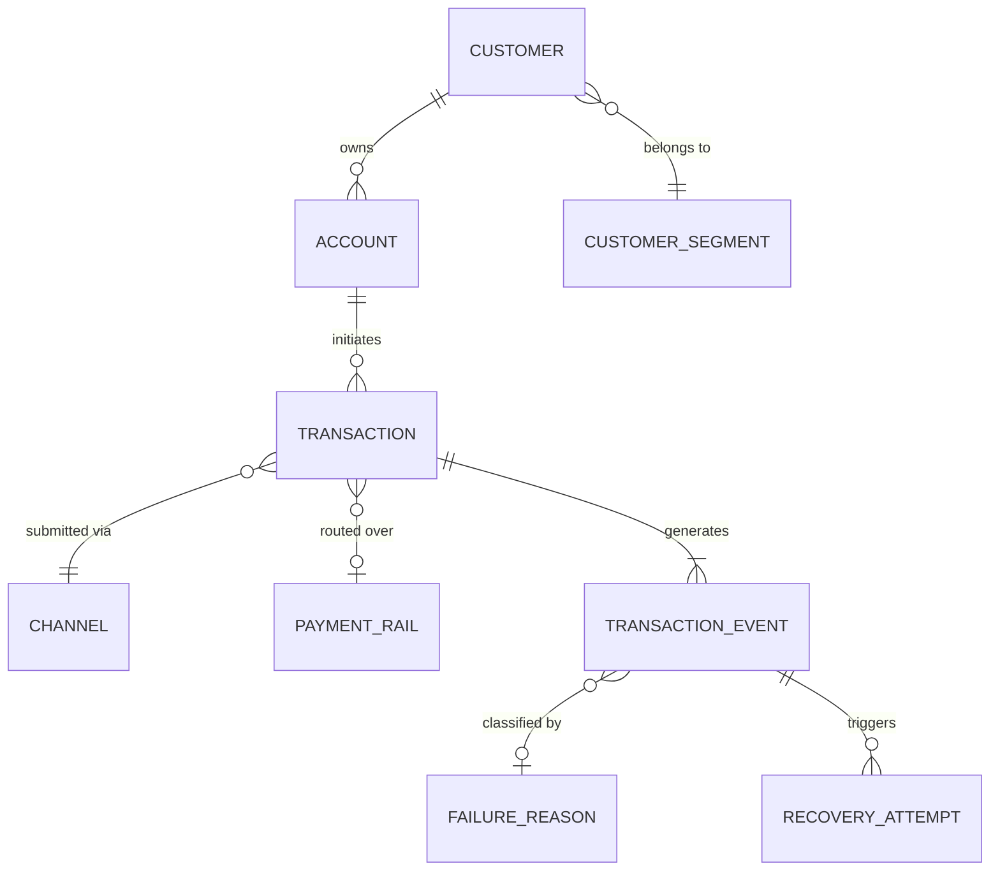
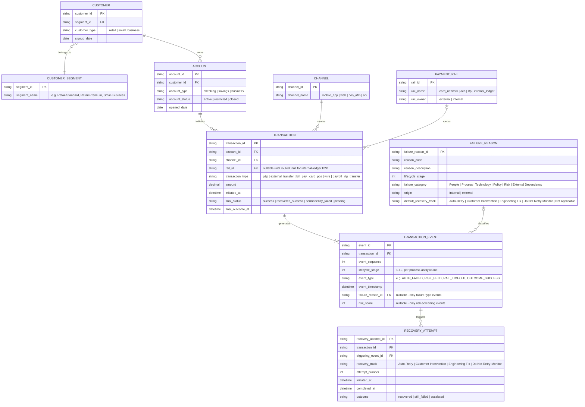

# Data Architecture: Transaction Lifecycle / Event Model

**Phase:** 6 of 20 — Data Architecture
**Depends on:** [process-analysis.md](./process-analysis.md), [future-state.md](./future-state.md)

---

## 1. Purpose and Design Principle

A single flat `transactions` table with a `status` column (success/failed) cannot answer most of the questions this project needs to answer: it can't show *where* in the lifecycle a transaction failed, whether it was retried, or how many attempts it took to recover. Phases 4 and 5 already established that a transaction moves through up to ten stages and can generate multiple recovery attempts before reaching a final outcome. The data model has to be built around that reality — **one transaction can have many lifecycle events, and a failed transaction can have many recovery attempts** — rather than around a single summary row per transaction.

This is the distinctive architectural choice this project is built on: an **event-sourced transaction lifecycle model**, not a flat transactions table.

---

## 2. Conceptual Data Model

At the conceptual level, the story this diagram tells is: a **Customer** (belonging to a **Segment**) owns one or more **Accounts**; an Account **initiates** Transactions over a **Channel** and (when applicable) a **Payment Rail**; every Transaction **generates** a sequence of lifecycle **Events**; an Event that represents a failure is **classified** against a standard **Failure Reason**; and a failure Event can **trigger** one or more **Recovery Attempts**.

---

## 3. Logical Data Model

---

## 4. Entity Descriptions

| Entity | Grain (one row =) | Why it exists |
|---|---|---|
| **Customer** | One synthetic customer | Needed for repeat-failure and segment analysis (BR-04); kept deliberately thin — no PII fields, only what segmentation and repeat-failure logic require (NFR-04) |
| **Customer Segment** | One segment definition | A lookup, not a computed field, so segment definitions can change without touching customer records — and so Finance/Support can reason about segments independent of any one customer |
| **Account** | One account belonging to one customer | Balance-validation failures (Stage 5) and account-status issues are account-level, not customer-level — a customer with a restricted account and a healthy one would be misrepresented if failures were tracked at the customer level only |
| **Channel** | One channel definition | Required directly by the channel-analysis questions in Phase 13 and by BR-01 |
| **Payment Rail** | One external (or internal-ledger) rail definition | Required by Stage 7's per-rail KPIs (process-analysis.md) — without this, "external dependency" would be a single undifferentiated bucket instead of attributable to a specific rail, which is exactly the ambiguity that made the Synapse–Evolve case hard to diagnose in real time |
| **Transaction** | One customer-initiated payment request | The unit the customer and Finance think in — one row per attempt the customer made, holding the final, current-state outcome |
| **Transaction Event** | One lifecycle-stage transition for one transaction | This is the model's core distinctive entity: a transaction's *history*, not just its *result*. A transaction that fails at Stage 4, gets auto-retried, and succeeds produces multiple event rows under one transaction_id — which is what makes lifecycle-stage and root-cause analysis (Phase 11) possible at all |
| **Failure Reason** | One standardized failure-reason definition | A controlled vocabulary, not free text — every reason is pre-classified by stage, category, internal/external origin, and default recovery track, so Phase 11's root-cause analysis and Phase 12's Recovery Opportunity Engine are querying structured data, not parsing strings |
| **Recovery Attempt** | One retry/recovery action taken against a specific failure event | Deliberately linked to the *triggering event*, not just the transaction — a transaction that fails twice, for two different reasons, should show two independently attributable recovery attempts, not one ambiguous "was it retried?" flag on the transaction |

---

## 5. A Deliberate Distinction: Recovery Attempt vs. a New Transaction

A design decision worth stating explicitly, because it's easy to get wrong: when the **system** retries a failed transaction automatically (Phase 5's Auto-Retry track), that is recorded as a new `TRANSACTION_EVENT` plus a `RECOVERY_ATTEMPT`, under the *same* `transaction_id` — it is the same customer request, retried. When a **customer** notices a failure and manually re-initiates the payment themselves (taps "send" again), that generates a **new** `transaction_id` with its own event history. These are analytically different things: the first is what Phase 12's recovery-rate KPI measures; the second is what Phase 3's repeat-failure customer segment (BR-04) measures. Collapsing them into one concept would understate how often customers are doing the bank's recovery work themselves — one of the findings this project is specifically positioned to surface.

---

## 6. What Was Deliberately Left Out

Section 9 of the master brief for this project lists **Device**, **Location**, and **Risk Indicators** as entities to consider. None of them became separate tables here, and the reasoning is recorded rather than silent:

- **Device**: no analytical question in this project's scope (Phase 3, Section 6; Phase 13) depends on device-level detail beyond what `channel_name` already captures (mobile app vs. web). Device-binding failures are represented as a `FailureReason` at Stage 2, which is enough to count and categorize them without a full device dimension.
- **Location**: Kestrel is digital-only with no physical channel, and no stated stakeholder need (Phase 2) requires geographic segmentation. Adding it would be complexity without a question it answers — exactly what the project's own design constraint warns against.
- **Risk Indicators**: rather than a separate table of individual risk signals, risk information is captured as attributes on the relevant `TRANSACTION_EVENT` row (`risk_score`) plus a standard `FailureReason` when a risk hold occurs. A later confirmation that a hold was a false positive is modeled as an **additional event** (e.g., `RISK_REVIEWED` / `CONFIRMED_LEGITIMATE`), consistent with the append-only event-log design, rather than as an update to a stored risk-indicator record.

---

## 7. Relationships and Cardinality Summary

| Relationship | Cardinality | Note |
|---|---|---|
| Customer → Account | 1 : N | A customer (especially small-business) may hold more than one account |
| Customer Segment → Customer | 1 : N | Each customer belongs to exactly one segment |
| Account → Transaction | 1 : N | An account initiates many transactions over time |
| Channel → Transaction | 1 : N | Each transaction is submitted through exactly one channel |
| Payment Rail → Transaction | 0/1 : N | Nullable — internal-ledger P2P transfers never leave Kestrel, so no external rail applies |
| Transaction → Transaction Event | 1 : N (minimum 1) | Every transaction has at least an "Initiated" event; most successful transactions will also have several intermediate stage-passed events |
| Failure Reason → Transaction Event | 0/1 : N | Only events representing a failure carry a failure reason; success events do not |
| Transaction Event → Recovery Attempt | 0 : N | Only failure events that are routed into a recovery track (Phase 5) generate recovery attempts |

---

## 8. Traceability to Phases 4 and 5

- `TRANSACTION_EVENT.lifecycle_stage` implements the 10-stage model from process-analysis.md directly — every stage in that document is a valid value here, not a re-derived concept.
- `FAILURE_REASON.failure_category` and `.origin` implement the People/Process/Technology/Policy/Risk/External-Dependency categories and the internal-vs-external distinction established in Phase 4 and used throughout Section 15 of the master brief.
- `FAILURE_REASON.default_recovery_track` and `RECOVERY_ATTEMPT.recovery_track` implement the four-track routing designed in future-state.md, Section 4 — including `Not Applicable`, reserved for Stage 3 validation failures, which future-state.md deliberately excluded from recovery routing.

---

## Open Items for Stakeholder Review

- Confirm the append-only event-log approach (a later risk review is a *new* event, never an edit to the original) is worth the added query complexity in Phase 10, versus a simpler mutable-status design — I've favored it because it matches how the false-positive-rate KPI (Stage 4, process-analysis.md) needs to be computed and keeps the model audit-friendly (NFR-05), but it does mean SQL queries need to reason about event sequences rather than just reading a current-state column.
- Confirm no separate `Device` or `Location` entity is genuinely unneeded — if you want device-level failure analysis as a stretch finding later, better to add `device_type` as a `Transaction` attribute now than retrofit it after the dataset is generated in Phase 8.
- Confirm `Payment Rail` as a first-class entity (rather than a string field on Transaction) is worth it — I've kept it separate specifically so Stage 7's per-rail KPIs and future rail-level exposure reporting don't require a schema change later.
