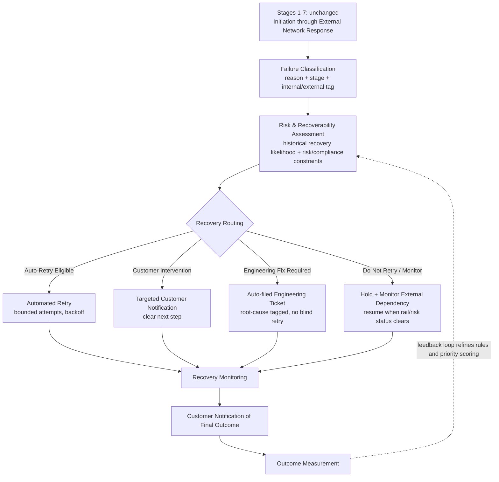

# Future-State Concept: Failure Intelligence & Recovery Orchestration

**Phase:** 5 of 20 — Future-State Concept
**Depends on:** [process-analysis.md](./process-analysis.md) (current-state lifecycle and failure points)

---

## 1. Purpose

Phase 4 established that Kestrel's current process has three structural gaps, not just isolated bugs: failures aren't classified in a structured way at the moment they happen (Stage 8), there is no systematic recovery mechanism (Stage 9 — most retries today are the *customer* noticing and trying again), and customers aren't proactively told the final outcome (Stage 10). None of these gaps require rebuilding the transaction lifecycle itself (Stages 1–7 stay as they are) — they require adding a new capability **after** Stage 7 that today doesn't exist at all. This document defines that capability conceptually; Phase 12 (Recovery Opportunity Engine) will give it its full scoring methodology, and Phase 25 (KPI Framework) will set its targets.

---

## 2. Design Principles

1. **Classify before you act.** No transaction should be retried, escalated, or silently dropped without first being tagged with a failure reason, lifecycle stage, and internal-vs-external origin (Phase 4, Section 4). This replaces today's ambiguous Stage 8.
2. **Every failure gets an owner, in real time — not after a support ticket.** Today, ownership is discovered reactively (Operations pages Engineering after enough alerts accumulate). In the future state, classification itself assigns an owner.
3. **Recovery actions are auditable by construction.** Because Risk & Fraud and Compliance hold veto power over any automated action (stakeholder-analysis.md, Section 3; BR-06/NFR-05), every routing decision must log which rule fired and why — not just what happened.
4. **The customer always gets a resolution message, not silence.** Whether the outcome is "recovered automatically," "here's what you need to do," or "this didn't work and here's why," the customer is told — closing Stage 10's notification gap directly.
5. **Don't over-automate.** Not every failure should be retried. A large part of this design's value is in the paths that deliberately *don't* auto-retry — this is a direct lesson from the Synapse–Evolve case, where the absence of a clear "is this actually recoverable, and by whom" decision, not too little automation, was the core failure.

---

## 3. Future-State Lifecycle

Stages 1–7 are intentionally untouched — this is a scoped addition to the lifecycle, not a core-banking rebuild, which matters for keeping the project's claims credible (business-case.md's realism rules).

---

## 4. What Changes at Each New Stage

**Failure Classification (new).** Replaces today's ambiguous Stage 8. Every failure is immediately tagged with a failure-reason code, the lifecycle stage it originated at, and whether it is internally addressable or externally dependent (Phase 4, Section 2). This alone eliminates the current-state "misclassification" failure point, because classification stops being an implicit, inconsistent judgment and becomes an explicit, ruled step.

**Risk & Recoverability Assessment (new).** Checks two things before anything is routed: (1) has this failure type historically recovered via retry, at what rate — this is exactly what Phase 12's scoring will formalize, and (2) does Risk or Compliance policy block automated action for this case (e.g., anything touching a risk-screening hold requires human review, never blind auto-retry — directly enforcing BR-06).

**Recovery Routing (new) — four tracks:**

| Track | When it applies | Example from Phase 4's failure points | Owner |
|---|---|---|---|
| **Auto-Retry Eligible** | Historically recoverable, low risk, no policy block | Stale-balance decline (Stage 5), rail timeout (Stage 7), risk-engine timeout (Stage 4), internal orchestration error *after* the bug is fixed | Engineering (automation), Operations (policy limits) |
| **Customer Intervention** | Recoverable only with customer action | Genuine insufficient funds (Stage 5) — a proactive low-balance nudge instead of a silent decline | Product / Customer Support |
| **Engineering Fix Required** | Root cause is internal and retrying won't help until it's fixed | Internal orchestration/routing error (Stage 6) — auto-files a tagged ticket instead of being silently retried into repeated failure | Engineering |
| **Do Not Retry / Monitor** | Not recoverable by Kestrel, or actively inappropriate to retry | Issuer decline (Stage 7, needs the customer's own bank/issuer), confirmed fraud/risk block (Stage 4), rail outage until it clears (Stage 7) | Risk & Fraud (fraud holds), Operations (rail status) |

A fifth case — validation failures on a malformed or invalid request (Stage 3) — deliberately sits **outside** this routing framework: it is not a "recovery" scenario at all, just a decline that needs clear at-the-moment messaging so the customer can correct their input. Forcing it into one of the four tracks above would blur what "recovery" means; the honest design choice is to leave it as a clear decline, not a routed failure.

The full scoring criteria, weights, and expected benefit/risk per track are Phase 12's job (the Recovery Opportunity Engine) — this phase establishes the four-track structure itself and which current-state failure points map to which track, which is what Phase 12 builds its scoring on top of.

**Recovery Monitoring (new).** Tracks every routed failure through to its actual outcome (recovered / still failed / escalated), which is the data Phase 25's recovery-rate KPIs are computed from.

**Customer Notification of Final Outcome (new).** Directly closes Stage 10's gap — every transaction resolves with an explicit, timely message to the customer, whether that outcome is good news or not, instead of resolving silently in the backend.

**Outcome Measurement / feedback loop (new).** Recovery outcomes feed back into refining the classification rules and (later) the Priority Score itself — e.g., if a failure type routed to "Auto-Retry" turns out to have a low real-world recovery rate, that's a signal to re-route it to "Investigate" rather than keep retrying it blindly.

---

## 5. What Is Preserved, What Is New

**Preserved (unchanged from current state):** Stages 1–7 of the transaction lifecycle, including which team owns each of them, and the fact that Kestrel still does not own the external payment rails — this future state does not claim to eliminate external-dependency failures, only to handle them more deliberately (Do Not Retry / Monitor, rather than being invisible until a customer complains).

**New:** A single capability — Failure Classification through Outcome Measurement — inserted once, after Stage 7, that every failure from any stage passes through. This is deliberately a shared, reusable layer rather than a bespoke fix per failure type, which is what makes it a capability investment rather than a one-off bug fix.

---

## 6. Relationship to Later Phases

- **Phase 6 (Data Architecture)** needs entities that can represent this: a transaction event log (for Failure Classification), a recovery-attempt log (for the four routing tracks and Recovery Monitoring), and a notification/outcome record.
- **Phase 12 (Recovery Opportunity Engine)** takes the four-track structure defined here and adds the actual scoring criteria, weights, and expected benefit/risk per category — this phase intentionally stops short of that so the two phases stay cleanly separated (concept vs. methodology).
- **Phase 25 (KPI Framework)** will attach target values to the KPIs implied here (retry success rate, time-to-recovery, notification latency) once Phase 10's baseline exists.

---

## Open Items for Stakeholder Review

- Confirm four routing tracks (Auto-Retry, Customer Intervention, Engineering Fix, Do Not Retry/Monitor) is the right structure — Phase 12 will formalize scoring on top of exactly these four, so any change here should happen before that.
- Confirm the decision to keep Stage 3 (validation failures) outside the recovery-routing framework entirely, rather than forcing it into "Customer Intervention."
- Confirm the Risk & Recoverability Assessment step's policy-block logic (Risk/Compliance can force human review regardless of historical recovery rate) is strict enough to satisfy BR-06 without making the whole system too conservative to show meaningful automation value in Phase 19's scenarios.
