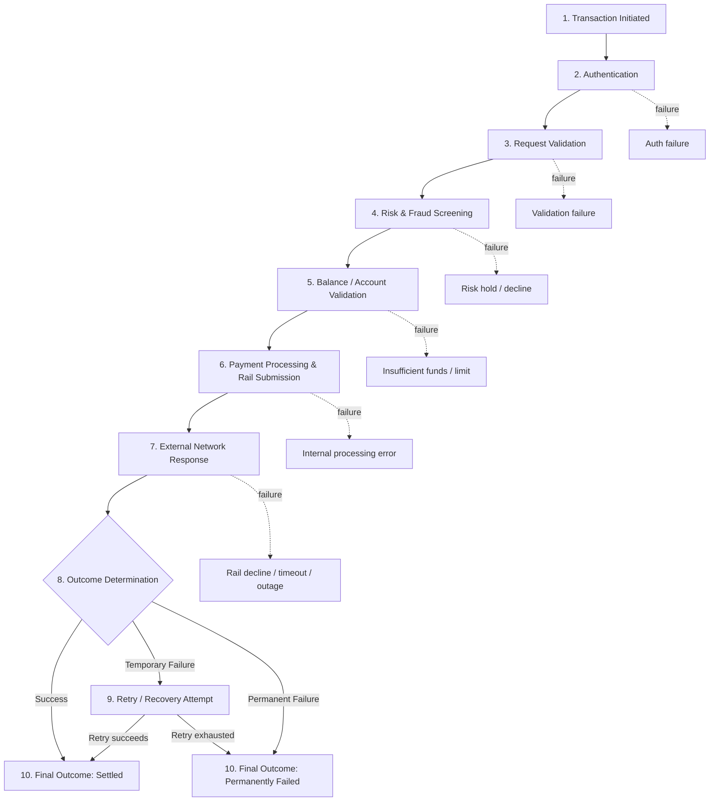

# Current-State Process Analysis: Transaction Lifecycle

**Phase:** 4 of 20 — Current-State Process
**Depends on:** [business-case.md](./business-case.md), [requirements.md](./requirements.md)

---

## 1. Purpose

Every downstream phase of this project — the data model (Phase 6), the SQL analysis (Phase 10), root-cause analysis (Phase 11), and the Recovery Opportunity Engine (Phase 12) — depends on a lifecycle model that is specific enough to actually locate a failure, not a generic "transaction happens, sometimes it fails" diagram. This document defines that lifecycle for Kestrel Bank as it exists today (current state), stage by stage, and consolidates the failure points and stakeholder pain points that Phase 5 (Future-State) will be designed to address.

---

## 2. Current-State Transaction Lifecycle

Each solid arrow is the happy path; each dashed arrow marks where the stage can exit into a failure instead of passing the transaction forward. This is deliberately **not** a single "success or failure" branch at the end — failures can originate at six different stages, and a transaction that fails at Stage 4 (risk screening) has a fundamentally different owner, cause, and remedy than one that fails at Stage 7 (an external rail timeout, structurally the same category of failure that turned into the Synapse–Evolve account freezes, per business-case.md Section 1).

---

## 3. Stage-by-Stage Analysis

### Stage 1 — Transaction Initiated
- **Process owner:** Product (channel team — mobile app / web / API)
- **Input:** Customer action (tap "Send," submit a bill pay, initiate a wire) with amount, counterparty, and channel
- **Output:** A transaction request object with a unique transaction ID, timestamped
- **Potential failure:** Client-side error (app crash, lost connectivity) before the request even reaches the backend
- **Failure category:** Technology
- **Customer impact:** Low — usually visible immediately and retried by the customer themselves
- **Business impact:** Low — rarely reaches the backend, so it doesn't consume downstream capacity, but high-volume client failures can mask a real app-stability issue
- **KPI:** Client-side initiation failure rate (app crash/network-loss rate at submission)

### Stage 2 — Authentication
- **Process owner:** Engineering (Identity & Access team)
- **Input:** Transaction request + customer session/device credentials
- **Output:** An authenticated request, or an authentication rejection
- **Potential failure:** Session expiry, device-binding mismatch, step-up authentication (e.g., biometric/OTP) failure
- **Failure category:** Technology / Policy (step-up auth policy thresholds)
- **Customer impact:** Medium — confusing when a customer believes they are logged in and the transaction is rejected anyway
- **Business impact:** Low-medium — usually resolves on retry, but repeated auth failures are a leading indicator of a broader session-management defect
- **KPI:** Authentication failure rate at point of transaction

### Stage 3 — Request Validation
- **Process owner:** Engineering (Payments Platform team)
- **Input:** Authenticated transaction request
- **Output:** A validated request (correct format, valid counterparty/account reference, within basic transaction limits) or a validation rejection
- **Potential failure:** Malformed request, invalid or closed destination account, transaction below/above allowed limits
- **Failure category:** Process / Technology
- **Customer impact:** Medium — often a clear, explainable decline (e.g., "recipient account not found"), less anxiety-inducing than an ambiguous failure
- **Business impact:** Low — typically not recoverable by retry (the input itself is invalid), but a spike here signals a UX defect upstream (e.g., a form allowing invalid input)
- **KPI:** Validation rejection rate; share of validation rejections traced to a UX/input defect vs. genuine invalid request

### Stage 4 — Risk & Fraud Screening
- **Process owner:** Risk & Fraud team
- **Input:** Validated transaction request
- **Output:** A risk decision — clear, elevated (step-up required), or blocked
- **Potential failure:** False-positive risk hold on a legitimate transaction; risk-engine latency causing a timeout
- **Failure category:** Risk / Technology
- **Customer impact:** High — a blocked legitimate transaction with no clear explanation is one of the most trust-damaging failure types, and is easily mistaken by the customer for a system bug
- **Business impact:** Medium-high — false positives suppress legitimate transaction volume (and the interchange/fee revenue attached to it), while true positives protect against fraud loss; the two must be measured separately (Phase 11 will not simply treat all risk declines as "bad")
- **KPI:** Risk-hold rate; false-positive rate (risk holds later confirmed legitimate); risk-engine timeout rate

### Stage 5 — Balance / Account Validation
- **Process owner:** Engineering (Ledger/Core Banking team)
- **Input:** Risk-cleared transaction request
- **Output:** Confirmed sufficient funds and account eligibility, or a decline
- **Potential failure:** Insufficient funds, account frozen/restricted, stale balance read (a caching or replication lag showing an out-of-date balance)
- **Failure category:** Process (insufficient funds is a legitimate decline) / Technology (stale balance read is a defect)
- **Customer impact:** Medium (genuine insufficient funds — expected) to High (a stale-balance decline on an account the customer knows has funds — confusing and directly analogous to the ledger-mismatch mechanism behind the Synapse–Evolve freezes)
- **Business impact:** Medium — a stale-read decline is fully recoverable (the money was always there) and represents pure avoidable friction if not caught
- **KPI:** Insufficient-funds decline rate (expected/benign) vs. stale-balance decline rate (defect — tracked separately)

### Stage 6 — Payment Processing & Rail Submission
- **Process owner:** Engineering (Payments Platform team)
- **Input:** Fully cleared transaction
- **Output:** A request submitted to the appropriate external rail (card network, ACH operator, or RTP network)
- **Potential failure:** Internal orchestration error, routing to the wrong rail, request malformed before hand-off
- **Failure category:** Technology
- **Customer impact:** Low-medium — usually indistinguishable to the customer from a rail-level failure (Stage 7), which is exactly why this stage needs to be logged separately, not lumped in
- **Business impact:** High if it occurs, because it is 100% within Kestrel's control and 100% avoidable — this is the highest-priority failure category for Engineering by construction
- **KPI:** Internal processing error rate (pre-rail-submission)

### Stage 7 — External Network Response
- **Process owner:** Not owned by Kestrel — external dependency (card network, ACH operator, or RTP network operator)
- **Input:** Submitted payment request
- **Output:** Network approval, network decline (e.g., the customer's linked card was declined by their issuer), or a timeout/outage
- **Potential failure:** Issuer decline, network timeout, full rail outage (the same failure mode behind the April 2025 UPI incidents referenced in business-case.md Section 1)
- **Failure category:** External Dependency
- **Customer impact:** High — from the customer's point of view this looks identical to every other failure, even though Kestrel has no direct control over it
- **Business impact:** Medium — not fixable by Kestrel engineering, but the *volume* of exposure to it is a product/architecture decision (e.g., which rails to route through, whether to offer a fallback rail)
- **KPI:** Rail decline rate, rail timeout rate, and rail outage minutes, tracked per rail so exposure to any single external dependency is visible

### Stage 8 — Outcome Determination
- **Process owner:** Engineering (Payments Platform team)
- **Input:** The result from Stage 6 or Stage 7
- **Output:** A determination: success, temporary/retryable failure, or permanent failure
- **Potential failure:** Misclassification — a temporary failure incorrectly marked permanent (a missed recovery opportunity) or vice versa (a wasted, doomed retry)
- **Failure category:** Process / Technology
- **Customer impact:** Medium — a misclassified failure either denies the customer a recovery they were entitled to, or subjects them to pointless retries
- **Business impact:** High — this is the single decision point the Recovery Opportunity Engine (Phase 12) exists to improve; getting this classification wrong is the direct cost driver behind under- or over-retrying
- **KPI:** Misclassification rate (measured retrospectively — temporary failures that were never retried but would have succeeded, and permanent failures that were retried anyway)

### Stage 9 — Retry / Recovery Attempt
- **Process owner:** Operations (currently manual/ad hoc) with Engineering-owned automated retry logic where it exists
- **Input:** A transaction flagged as a temporary/retryable failure
- **Output:** A recovered (successful) transaction or an exhausted-retries permanent failure
- **Potential failure:** No retry attempted at all (today, most retries are customer-initiated, not systematic); retrying a failure type that was never actually recoverable (wasted attempt, risk exposure)
- **Failure category:** Process (today: absence of a systematic retry policy)
- **Customer impact:** High — this is the stage where "does the bank actually try to fix this, or does the customer have to notice and retry it themselves" is decided
- **Business impact:** High — this is the stage Phase 12 (Recovery Opportunity Engine) and Phase 19 (Scenario B, Automated Retry) are built around; today it is largely unmanaged
- **KPI:** Retry rate (of eligible failures), retry success rate, average time-to-recovery

### Stage 10 — Final Outcome
- **Process owner:** Engineering (Payments Platform team) for the record; Customer Support for any resulting contact
- **Input:** The result of Stage 8 or Stage 9
- **Output:** Settled-success, recovered-success, or permanently-failed — the state the customer and all downstream reporting see
- **Potential failure:** Delayed or unclear communication of the final outcome to the customer (the transaction resolves in the backend but the customer isn't told)
- **Failure category:** Process
- **Customer impact:** High — an unresolved-looking transaction, even after backend resolution, is a top driver of Support contacts (Customer Support Operations Lead's stated pain point, stakeholder-analysis.md)
- **Business impact:** Medium — avoidable Support cost, and a churn-risk moment even when the money was never actually at risk
- **KPI:** Time from final backend outcome to customer-visible notification; repeat-contact rate for already-resolved transactions

---

## 4. Consolidated Failure Point Summary

| Stage | Failure Point | Category | Typically Recoverable? | Severity |
|---|---|---|---|---|
| 2. Authentication | Session/device/step-up auth failure | Technology / Policy | Yes (retry) | Low |
| 3. Request Validation | Invalid request or destination account | Process / Technology | No (input issue) | Low |
| 4. Risk Screening | False-positive risk hold | Risk / Technology | Sometimes (needs review, not blind retry) | High |
| 4. Risk Screening | Risk-engine timeout | Technology | Yes (retry) | Medium |
| 5. Balance Validation | Genuine insufficient funds | Process | No (needs customer action) | Low |
| 5. Balance Validation | Stale-balance decline | Technology | Yes (retry) | High |
| 6. Payment Processing | Internal orchestration/routing error | Technology | Yes (retry, and should never recur) | High |
| 7. External Network | Issuer decline | External Dependency | No (needs customer/issuer action) | Low |
| 7. External Network | Rail timeout | External Dependency | Yes (retry) | Medium |
| 7. External Network | Rail outage | External Dependency | Yes, but only after outage clears | High (low frequency, high blast radius) |
| 8. Outcome Determination | Misclassification of temporary vs. permanent | Process / Technology | N/A — this *causes* mis-recovery elsewhere | High |
| 9. Retry/Recovery | No systematic retry exists today | Process | N/A — this is the gap, not a failure mode | High |
| 10. Final Outcome | Delayed/unclear customer notification | Process | N/A — resolved but not communicated | Medium |

This table is the direct input to Phase 11's root-cause prioritization — it already separates failures that are genuinely not recoverable (insufficient funds, invalid destination, issuer decline) from ones that are, which prevents the common mistake of treating "recoverable" as a synonym for "should always be retried."

---

## 5. Pain Points (Stakeholder View)

Reading the failure points above through the stakeholders defined in Phase 2:

- **Operations Manager** — has no way today to tell, at the moment an alert fires, whether it's Stage 6 (Kestrel's own bug — urgent) or Stage 7 (an external rail issue Kestrel can't fix — monitor, don't page Engineering).
- **Engineering Lead** — Stage 8's misclassification problem means Engineering sometimes gets paged for what was actually a successful retry, and sometimes doesn't get paged for a real recurring internal error, because both look identical downstream today.
- **Risk & Fraud Lead** — Stage 4's false-positive risk holds are currently indistinguishable, in complaint data, from every other "my transaction failed" contact — there is no separate signal telling Risk how much legitimate volume its own screening is suppressing.
- **Customer Support Operations Lead** — Stage 10's notification gap is a direct driver of repeat contacts: customers call in about transactions that already resolved successfully in the backend.
- **Finance** — cannot currently separate Stage 5's "genuine insufficient funds" (not a loss — expected customer behavior) from Stage 5's "stale-balance decline" (a pure defect, fully recoverable, and currently invisible as its own category).
- **Customers** — experience nearly every one of the failure points above identically, as "it didn't work," regardless of whether the cause was a 2-second fixable bug (Stage 6) or something genuinely outside Kestrel's control (Stage 7) — this undifferentiated experience is the core customer-facing symptom the whole project exists to fix.

---

## Open Items for Stakeholder Review

- Confirm the 10-stage lifecycle is the right level of granularity — it could be collapsed (e.g., merge Stages 2–3) or split further (e.g., separate device-binding failures from session-expiry within Authentication) before Phase 6 turns it into a data model.
- Confirm the Stage 8 "misclassification" failure point is worth carrying forward as its own tracked category — it's a process failure *about* the lifecycle rather than a stage failure *within* it, which is a slightly different kind of finding than the rest of the table.
- Confirm the Severity ratings in Section 4 (a qualitative call, not yet data-driven) are directionally reasonable — they will be replaced with the quantified Priority Score in Phase 11 once real analysis exists.
